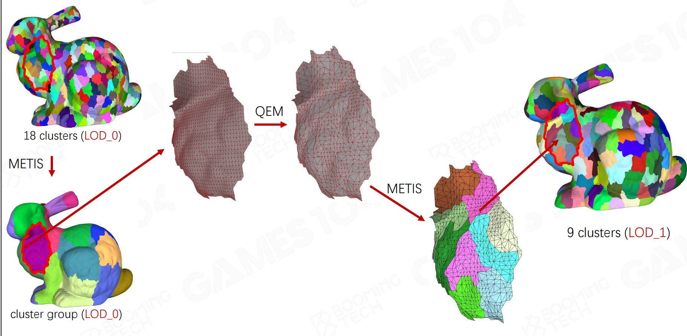

- [Bottleneck and Solution of Traditional Rendering Pipeline](#bottleneck-and-solution-of-traditional-rendering-pipeline)
  - [High CPU Overload](#high-cpu-overload)
  - [GPU State Exchange Overhead](#gpu-state-exchange-overhead)
  - [Batching](#batching)
  - [Instancing](#instancing)
- [Key Ideas of GPU-Driven Pipeline](#key-ideas-of-gpu-driven-pipeline)
  - [Indirect Draw](#indirect-draw)
  - [GPU-Driven Culling](#gpu-driven-culling)
  - [Mesh Cluster Rendering](#mesh-cluster-rendering)
- [New Generation Graphics API](#new-generation-graphics-api)
  - [Validation Layer](#validation-layer)
  - [Command Buffer](#command-buffer)
  - [Descriptor Indexing](#descriptor-indexing)
  - [Device Address Model](#device-address-model)
  - [Compute Shader](#compute-shader)
- [Nanite: State-of-the-Art in GPU-Driven Pipeline Architecture](#nanite-state-of-the-art-in-gpu-driven-pipeline-architecture)
  - [Geometory Represetation](#geometory-represetation)
  - [Runtime LoD Selection](#runtime-lod-selection)
  - [Nanite Rasterization](#nanite-rasterization)
  - [Summary](#summary)
- [Reference](#reference)

GPU驱动管线（GPU-Driven Pipeline）是一种将原本由CPU承担的大量渲染任务转移到GPU上进行处理的渲染管线架构。在传统渲染管线中，CPU负责管理场景中的大量数据，如模型的加载、裁剪、排序以及绘制调用的提交等，这使得CPU成为渲染流程中的瓶颈。而GPU驱动管线则通过Indirect Draw、Compute Shader等机制让GPU能够更自主地处理这些任务，充分发挥其强大的并行计算能力，从而突破了渲染性能。

## Bottleneck and Solution of Traditional Rendering Pipeline

### High CPU Overload

在传统渲染架构中，CPU 承担了过多的非图形渲染计算，主要体现在：

- 繁重的裁剪与剔除：视锥剔除、遮挡裁剪、以及细节层次（LoD）的选择在传统模式下主要由 CPU 端通过八叉树或包围盒算法串行或简单多线程处理，消耗了大量的 CPU 周期。
- 高频的 Draw Call 数据准备：场景中每一个独立的物体或材质变化，都需要 CPU 向图形驱动发起一次绘制调用。当场景物体达到百万级时，CPU 根本无法在有限时间内完成指令提交。
- 算力失衡：随着 GPU 硬件架构的飞速演进，专用于并行计算的 GPU 吞吐量呈指数级增长，而 CPU 的处理速度逐渐难以跟上图形硬件的步伐，导致 GPU 经常处于“饥饿”等待状态。

### GPU State Exchange Overhead

**GPU architecture**:

为了理解 Draw Call 对 GPU 的影响，首先需要了解 GPU 的层次结构。以 Nvidia GPU 为例，其基本计算和调度单位称为 SM（Streaming Multiprocess）。在概念上，SM 类似于 CPU 的 Core，都是独立的执行单元；但二者的底层架构存在本质差异：CPU Core 主要基于 SISD/MIMD 架构，注重单线程的低延迟执行；而 GPU SM 则基于 SIMT 架构，允许一组线程在同一时刻执行同一条指令，但各自处理不同的数据。

相比传统的 SIMD 向量架构，现代 GPU 的 SIMT 提供了更高级且灵活的逻辑抽象：它将每个工作单元抽象为独立的硬件线程，拥有专属的线程 ID、寄存器状态和程序计数器。当执行代码中出现 if-else 等分支发散（Branch Divergence）时，硬件可以通过执行掩码（Execution Mask）动态挂起不满足条件的线程，串行化地依次执行不同分支路径，待分支结束后再重新合流执行。

需要特别指出的是，尽管 CPU 与 GPU 都使用了“Core”这一术语，但二者对应的硬件层级截然不同：

- CPU Core：是具备分支预测、乱序执行及多级缓存的完整独立计算实体。
- GPU Core（如 CUDA Core）：仅为 SM 内部的一个极简算术逻辑单元（ALU），必须由成百上千个 Core 组合在一起协作运行。

如图所示，一个典型的 SM 内部模块按功能主要划分为：

- 计算与执行单元（Execution Units：
  - **CUDA Core (ALU / FPU)**：负责基础的 32 位/64 位整型（INT32）与单/双精度浮点数（FP32/FP64）算术逻辑运算。
  - **SFU (Special Function Unit)**：专用于加速超越函数（如 $\sin$、$\cos$、$\ln$、平方根倒数等）与插值运算的硬件电路。
  - **Tensor Core**：专用于混合精度矩阵乘加（MMA）运算的硬件加速阵列，支撑深度学习（如 DLSS）与高性能矩阵计算。
  - **RT Core**：专用于加速 BVH 树遍历与射线-三角形求交测试的专用硬件。

- 指令调度与分发（Control & Scheduling）：
  - **Warp Scheduler**：负责监控并选取已就绪的 Warp（通常为 32 个线程组成的执行线程束），管理线程束的挂起与激活。
  - **Dispatch Unit**：负责将 Warp Scheduler 选出的指令解码并精准发射分发至对应的执行单元（CUDA Core、SFU、LD/ST 等），确保硬件流水线保持满载运行。

- 数据访问与存储（Memory & Cache）：
  - **Register File**：为海量并发线程提供极速的片上零延迟存储，用于保存通用寄存器数据及线程 ID、程序计数器等上下文状态。
  - **LD/ST Unit (Load/Store Unit)**：负责处理内存加载与存储指令，内部集成了复杂的访存合并（Memory Coalescing）与共享内存 Bank 冲突仲裁逻辑。
  - **Tex Unit / Texture Cache**：负责纹理采样的硬件过滤（双线性/三线性/各向异性）、Mipmap 计算、格式解压以及二维空间局部性缓存。
  - **Shared Memory / L1 Data Cache**：SM 内部高带宽、低延迟的片上 SRAM 存储池，由开发者显式控制（Shared Memory）或由硬件自动管理（L1 Data Cache），用于线程块（Block）内的数据共享与高速复用。


在 NVIDIA 的架构设计里，SM 的上一级封装通常称为 TPC（Texture Processing Cluster），而多个 TPC 进一步构成了 GPC（Graphics Processing Cluster）。

- PolyMorph Engine：通常与 SM 紧密伴生，负责处理几何阶段的核心任务，包括顶点属性获取（Vertex Fetch）、曲面细分（Tessellation）、视口变换及几何属性设置。
- Rasterizer：负责将经过几何变换的图元离散化为屏幕像素片段，并为后续阶段计算插值所需的重心坐标。
- ROP（Render Output Unit）：位于管线的“最后一公里”，紧邻显存控制器，专门负责执行深度测试（Depth Test）、模板测试（Stencil Test）、Alpha 混合（Blending）以及像素颜色的最终写入。
- Global L2 Cache：位于整颗芯片的核心枢纽位置，被所有 SM 共享，用于缓存高频访问的纹理、顶点和缓冲区数据，大幅降低全局显存（VRAM）的访问延迟。
- Memory Controller：环绕在芯片外围的高速物理接口，直接对接 GDDR 或 HBM 显存颗粒，负责管理海量数据的进出总线吞吐。

**Fixed-function state**:

Draw Call 触发的状态切换，主要指光栅化器、ROP、混合单元、深度/模板测试单元、着色器绑定、纹理绑定、顶点输入布局等固定功能或管线状态的变更。这和 CPU 多线程中切换上下文的方式完全不同：

- CPU 切换线程时需要保存和恢复寄存器、栈指针、程序计数器等线程上下文；
- 而 GPU 切换 Draw Call 时并不是为每个 Draw Call 保存完整线程上下文，而是要保证整条渲染管线的配置与新绘制任务一致。

因此，GPU 中 Draw Call 切换的本质是固定功能模块和管线状态的重新配置，而非线程上下文的替换。

**Finite state machine**:

为了理解为什么频繁切换状态会导致性能崩塌，我们需要从硬件底层和驱动两方面来剖析：

- **硬件等待**：GPU 是一头依赖极深流水线与海量并行（SIMT）吞吐的巨兽。当渲染管线正在高速处理数据时，如果频繁更改状态（如混合模式、深度测试、光栅化规则），硬件被迫进行流水线排空（Pipeline Flushing），等待旧任务清空；同时，底层的固定功能硬件（如 ROP 渲染输出单元、光栅化器）必须重新配置物理电路，这会产生严重的硬件气泡和算力浪费。

- **驱动验证**：在传统 API 下，每次调用绘制命令或切换状态时，CPU 端的图形驱动程序必须在后台进行海量的动态验证。驱动需要实时检查当前的所有状态、纹理绑定和着色器是否冲突，并动态翻译成硬件能懂的寄存器指令。

这种双重压力（CPU 驱动验证开销 + GPU 硬件流水线重建代价）构成了传统 API 挥之不去的性能瓶颈。

### Batching

合批（Batching）的核心目标是在 CPU 端减少 Draw Call 和渲染状态切换次数。当多个物体共享相同的材质、着色器和纹理时，可以将它们的几何数据合并后通过一次 Draw Call 提交，从而避免为每个物体重复设置相同的渲染状态。

常见的合批方式包括静态批处理和动态批处理。静态批处理在编辑期或加载阶段将多个静态物体的网格合并为一个大网格，运行时 CPU 开销极低，但会增加内存占用，且合并后无法单独移动或变换子物体。 动态批处理则在运行时由 CPU 将共享相同材质的小型动态物体合并后提交，由于每帧都需要进行顶点变换和网格合并，开销较大，且对顶点数量有严格限制，在现代低开销 API 下优势并不明显。

合批的本质是化零为整，用更大的单次 Draw Call 换取更少的状态切换。但过度合批也会导致单个 Draw Call 处理时间过长，因此需要在 CPU 开销和 GPU 负载之间取得平衡。

### Instancing

针对场景中大量几何形状完全相同、但位置、旋转、缩放各异的物体，传统管线引入了实例化渲染。其核心思想在于，预先传递一个包含所有实例特有属性（如变换矩阵、颜色等）的缓冲区，随后顶点着色器通过内置的实例索引从缓冲区中精准抓取专属数据，进而为每个实例完成差异化渲染。

值得注意的是，我在[Tiny PBR Renderer](https://github.com/Zhytou/tinyrenderer/)项目中使用 glBindRange 不断修改 UBO 的绑定范围，再调用 glDrawElements 的方式并非真正的实例化渲染。实际上，它是一种“伪实例化”，即每个 Draw Call 都对应一个实例，而不是多个实例共享一个 Draw Call。

而想要实现真正的实例化渲染，则通常需要借助 SSBO 以及 glDrawElementsInstanced 来实现。具体而言，它的实现步骤如下：

- 将所有实例各自的属性（如变换矩阵、颜色等）组织到一个 SSBO 中，每个实例的属性连续存储。

```c++
// 1. 准备所有实例的变换矩阵数据
std::vector<glm::mat4> instanceMatrices = { /* 填充各个实例的矩阵... */ };

// 2. 创建并填充 SSBO
unsigned int instanceSSBO;
glCreateBuffers(1, &instanceSSBO);
glBufferData(GL_SHADER_STORAGE_BUFFER, instanceMatrices.size() * sizeof(glm::mat4), instanceMatrices.data(), GL_STATIC_DRAW);

// 3. 将 SSBO 绑定到 Shader 中对应的 binding 点（例如 0）
glBindBufferBase(GL_SHADER_STORAGE_BUFFER, 0, instanceSSBO);
```

- 对于 VAO/VBO/EBO 的初始化，保持不变。只不过在绘制时，使用 glDrawElementsInstanced 接口指定实例总数。

```c++
// 绑定小球自身的网格 VAO
glBindVertexArray(ballVAO);

// 核心：单次 Draw Call 绘制所有实例
glDrawElementsInstanced(
    GL_TRIANGLES,       // 绘制图元类型
    indexCount,         // 单个网格的索引数量
    GL_UNSIGNED_INT,    // 索引数据类型
    0,                  // 索引缓冲区偏移
    instanceCount       // 实例总数（例如 10 个）
);
```

- 最后，在顶点着色器中通过内置的实例索引 gl_InstanceID 从缓冲区中精准抓取专属数据，为每个实例完成差异化渲染。

```glsl
#version 430 core

layout (location = 0) in vec3 aPos; // 小球自身的顶点坐标

// 关键：声明一个和 CPU 对应的高速显存块 (SSBO)
layout (std430, binding = 0) buffer InstanceData {
    mat4 instanceMatrices[]; // 这是一个变长数组，里面装着刚才 CPU 传进来的 10 个矩阵
};

uniform mat4 projection;
uniform mat4 view;

void main() {
    // 灵魂代码：
    // 用硬件自动生成的 gl_InstanceID 作为下标，直接去 SSBO 数组里抓取当前实例的专属矩阵！
    mat4 model = instanceMatrices[gl_InstanceID];
    
    // 计算最终顶点位置
    gl_Position = projection * view * model * vec4(aPos, 1.0);
}
```

与合批相比，实例化不需要在 CPU 端合并网格，每个实例仍可独立控制变换和参数，内存开销也更低。但它局限于同质化模型的合并——所有实例必须共享相同的网格和材质。 此外，其实例数据的组织与动态管理在传统管线中依然强依赖 CPU，无法灵活应对复杂的动态裁剪与多级 LOD 选择。

这也是为什么更进一步的 GPU-Driven Pipeline 会将剔除、LOD 选择和实例数量计算都搬到 GPU 上，通过 DrawIndexedIndirect / DrawMeshInstancedIndirect 让 GPU 自主决定“画什么、画多少个”。

## Key Ideas of GPU-Driven Pipeline

### Indirect Draw

**Draw from GPU buffer**：

GPU驱动管线的核心目标是最小化CPU参与渲染流程的频率。传统绘制方式（如 glDrawArray/glDrawElements）需由CPU直接传递绘制参数（如图元数量、索引范围等），这会导致CPU-GPU通信开销较高。间接绘制则将这些参数存储在GPU可访问的缓冲区中，由GPU自行读取参数并执行绘制，从而大幅减少CPU的介入。

**New API support**：

```glsl
// CPU直接传递参数
glDrawElements(GL_TRIANGLES, 6, GL_UNSIGNED_INT, 0); 

// 参数来自GPU缓冲区
glDrawElementsIndirect(GL_TRIANGLES, GL_UNSIGNED_INT, buffer_offset);
```

尽管早期的渲染API（如 OpenGL 4.x）已引入了间接绘制指令，但受限于其状态机架构与隐式同步机制，CPU仍需承担较重的指令验证负担。而 Vulkan 和 DX12 等新一代API通过底层重构，彻底释放了 GPU-Driven Rendering 的潜力。以 Vulkan 为例，它相比 OpenGL，做了如下优化：

- 高度并行的多线程指令录制：Vulkan 彻底摒弃了 OpenGL 的单线程状态机限制。它允许开发者为每个线程创建独立的命令缓冲（Command Buffer），每个缓冲均封装了完整的渲染状态。这种设计消除了线程间的竞争与上下文切换开销，使CPU的多核性能在指令录制阶段得到充分爆发。

- 显式的同步与执行控制：虽然不同线程可以并行录制，但GPU执行指令通常遵循特定的逻辑顺序。Vulkan 不再依赖驱动进行同步，而是提供了屏障（Barriers）、栅栏（Fences）和信号量（Semaphores）等精细化工具。开发者通过这些机制手动确保显存可见性与执行时序，在消除隐式同步卡顿的同时，保证了渲染结果的确定性。

- 精细化的资源与生命周期管理：在 Vulkan 中，内存分配、资源绑定以及缓冲区的生存周期完全交由开发者掌控。这种“所见即所得”的模式消除了传统API内部频繁的引用计数与自动内存重排开销，大幅降低了驱动层的CPU占用（Driver Overhead），使每一份算力都精准作用于渲染流水线。

### GPU-Driven Culling

裁剪（Culling）是根据观察区域确定图形对象可见部分并移除不可见部分的过程。它通过减少冗余数据处理，显著提升渲染效率。

**Conventional culling**：

在传统渲染管线中，可用于裁剪的时间点包括：

- 加载或更新模型时；
- 光栅化之间；
- 光栅化之后片元着色之前。

其中，将数据传入顶点着色器之前的裁剪任务由CPU驱动，它包括：

- 细节剔除（Detail Culling）：根据物体与相机的距离，选择不同细节程度的模型进行渲染。这一过程中，CPU负责根据物体的距离和其他条件来选择合适的层次细节（Level of Detail, LoD）模型，然后将其传递给GPU进行渲染。
- 遮挡裁剪（Soft Occlusion Culling）：预处理判断物体遮挡关系，并以剔除。这一操作可以在CPU端进行预处理，通过一些算法（如八叉树、层次包围盒等）来快速判断，也可以在GPU端使用硬件加速算法如Early-Z等来实现。

而由GPU硬件完成的裁剪则包括：

- 视锥剔除（Frustum Culling）：检测物体是否位于视锥体内，直接剔除或裁剪视锥体外部的图元。
- 背面剔除（Backface Culling）：基于三角形面的法线方向（如右手定则）剔除不可见的背面图元，减少无效渲染计算。

**Compute based culling**：

随着 GPU 计算能力的提升，GPU-Driven Culling 技术逐渐成为主流。它将裁剪任务从 CPU 转移到 GPU 上进行处理，充分发挥 GPU 上的硬件并行计算能力，提升渲染效率。具体而言，它常常和间接绘制参数生成的逻辑放在一起，由 Compute Shader 一并实现。

### Mesh Cluster Rendering

**Mesh clustering**：

通过将场景中具有​​相似渲染属性​​（如材质、着色器、纹理、渲染状态等）的网格对象动态划分为若干​​簇（Cluster）​​，每个集群内的子网格（Sub-Mesh）共享相同的渲染资源。

**Avoid frequent state switch**：

通过批量处理同一集群内的网格数据，从而最小化CPU与GPU之间的状态切换开销，实现高效批量渲染。

## New Generation Graphics API

传统 OpenGL 长期采用隐式状态机模型：驱动负责状态跟踪、资源管理、同步和命令调度，开发者只需调用高层 API，但这也意味着大量 CPU 开销被隐藏在驱动内部，难以预测、难以多线程化。

新一代图形 API——Vulkan、DirectX 12、Metal，以及后来继承其理念的 WebGPU——共同的设计方向是 显式控制、低开销、多线程友好、图形与计算统一。 它们把内存分配、管线状态、资源绑定、命令录制和同步原语都暴露给开发者，驱动不再猜应用意图，而是按应用明确提交的命令执行。 在这种范式下，GPU 不再只是画三角形和像素的硬件，而是一个可编程的并行计算引擎；渲染管线中的许多环节——剔除、LOD 选择、粒子更新、间接绘制参数生成——都可以从 CPU 转移到 GPU 上完成。

### Validation Layer

正如 [GPU State Exchange Overhead](#gpu-state-exchange-overhead) 所述，频繁提交 Draw Call 造成的性能瓶颈，除了受硬件流水线的频繁排空影响之外，很大一部分源于驱动层的实时验证与状态转换开销。在 OpenGL 的隐式全局状态机设计下，驱动被迫在每次触发绘制时，实时检查当前繁杂的全局状态、纹理绑定与着色器之间是否存在冲突，并动态翻译成底层硬件指令。

相比之下，现代 API 凭借管线状态对象（Pipeline State Object，PSO）的显式静态打包设计，将原本散落的深度测试、裁剪模式、混合模式等硬件固定功能提前在初始化时进行“打包与静态体检”。这使得验证层（Validation Layer）能够作为一种可插拔的独立中间件而存在：

- 在开发阶段初始化或资源创建的第一时间精准拦截状态错配、资源生命周期违规及同步漏洞；
- 在发布阶段又可以被彻底卸载，从而实现零运行时验证开销。

不仅如此，验证层的职责远不止于 PSO 状态的合法性检查，而是全面覆盖了现代图形 API 的整个生命周期：

- 资源生命周期管理：精准追踪每一个 Buffer、Image 与 Descriptor Set。若试图销毁正被 GPU 读取的资源，或在提交 Command Buffer 前提前释放内存，验证层会立即发出拦截警告。
- 同步与内存屏障（Sync Validation）：深度分析命令缓冲区中的读写依赖关系，自动揪出遗漏的 Pipeline Barrier，有效避免数据竞争与潜在的渲染崩溃。

### Command Buffer

### Descriptor Indexing

### Device Address Model

### Compute Shader

**High-speed general purpose computing**：

为了动态生成间接绘制的参数，现代渲染管线又引入了另一项关键技术，也即通用计算着色器 Compute Shader。与传统的 Vertex Shader 和 Fragment Shader 不同，Compute shader 不直接参与图形渲染，而是专注于利用 GPU 的大规模并行计算能力执行非图形渲染任务。比如，根据场景数据来决定实际需要绘制的图元数量，从而避免不必要的渲染操作。换句话说，Compute Shader 是 GPU 通用计算能力在渲染管线中的直接体现。

此外，它和 CUDA / OpenCL 并不属于同一个体系。CUDA 和 OpenCL 是独立的通用计算平台，拥有自己的运行时、编译器和生态；而 Compute Shader 是图形 API（OpenGL / Vulkan / DirectX / Metal）原生的一部分，与渲染管线共享上下文、资源和同步机制。这意味着在渲染引擎内部，Compute Shader 可以零额外开销地与 SSBO、纹理、间接绘制缓冲等资源交互，而无需像 CUDA/OpenCL 那样建立额外的资源互操作通道。

**Key features**：

- Parallel Processing：Compute Shader 可同时处理数千个线程，极大地提高了数据处理效率。
- Shared Memory：支持线程组内的快速数据共享，减少全局内存访问。
- Barriers：提供线程同步机制，确保数据一致性。
- Atomic Operations：支持原子操作，如递增、比较和交换等。

**Typical use cases**：

- Tessellation Control：根据LOD需求动态生成网格细分级别。
- Culling：执行视锥体剔除、遮挡剔除等操作，筛选可见物体。
- Physics Simulation：实现流体模拟、布料模拟等物理效果。

**Input and output**：

与传统图形管线（输入依赖 VBO/VAO，输出必须经过光栅化并写入 FBO 纹理或屏幕缓冲区）不同，Compute Shader 是完全脱离固定图形管线的自由计算单元。它没有顶点或片元概念，其输入和输出可以来自显存中的任意数据块——SSBO、纹理、图像、间接绘制缓冲均可作为读写载体。CPU 负责将数据提交到 GPU 缓冲区并 dispatch 计算任务，Compute Shader 完成处理后，结果可以直接被后续的图形绘制消费，也可以由 CPU 通过映射或 PBO 读回。

**Simple example**：

值得注意的是，Compute Shader 并非新一代 API 才出现的能力。OpenGL 4.3 已通过 ARB_compute_shader 正式引入计算着色器。为前后文统一，此处仍以 OpenGL 为例。

## Nanite: State-of-the-Art in GPU-Driven Pipeline Architecture

Nanite是虚幻引擎5引入的​​虚拟化几何系统​​，旨在实现​​电影级高精度模型​​的实时渲染。其核心思想是通过智能的​​数据流式加载​和​​GPU驱动的渲染管线​​，动态适应不同视角下的几何细节需求，从而突破传统渲染的三角形数量限制。

### Geometory Represetation

**Represent geometry by clusters**：

在Nanite中，模型总是按簇（Cluster）进行处理。具体而言，这些簇具备以下特点：

- 128个三角形：每个簇包含最多128个三角形和128个顶点。
- 同质性：同一个簇内的三角形必须共享相同的材质索引和顶点属性布局。
- 压缩：每个簇的数据经过高度位压缩（Bit-packing），并使用相对于簇包围盒的局部坐标以节省空间。

**Cluster groups and DAG hierarchy**：

- 分组与简化：引擎将相邻的 4 到 8 个簇组合成一个簇组（Cluster Group），并对其进行减面简化，生成一个父级簇。
- DAG 结构：由于一个简化后的父簇可能由多个子簇合并而来，且不同路径可能共享边界，因此它们形成了DAG有向无环图。
- 强制共享边界：在简化过程中，Nanite 会锁定簇与簇之间的边缘顶点。这确保了无论实时渲染时选择了哪个层级，相邻簇之间的接缝（Seams）永远是完美匹配的，彻底解决了传统LoD切换时的跳变（Popping）问题。

### Runtime LoD Selection

**Traditional mesh LoD**：

在传统渲染中，为了在保证视觉效果的同时有效降低计算和内存开销，通常会对远离视点的物体采用简化处理，这一策略被称为层次细节（Level of Detail, LoD）。具体而言，常见的 LoD 实现方式包括：

- 纹理层面：普遍采用 Mipmap 技术，即预先生成一系列逐级缩小的纹理图，并根据屏幕空间中相邻像素的纹理坐标梯度（或导数）动态选择最匹配的层级，以减少采样走样并提升缓存效率；
- 模型层面：为同一物体预先构建多个不同复杂度的网格模型（如高模、中模、低模），并在运行时依据物体到视点的距离切换使用相应精度的版本。

然而，这种基于离散 LoD 层级的切换机制存在明显缺陷：当物体跨越LoD切换阈值时，容易出现视觉跳变（Popping）；更严重的是，在场景中相邻物体处于不同LoD层级时，由于顶点位置不一致，常在接缝处产生几何裂缝（Edge Cracks），破坏模型连续性与画面整体性。

**LoD selection based on DAG hierarchy of cluster group**：

相比之下，Nanite 通过采用基于簇的模型表达方法，避免了传统的离散 LoD 切换机制的跳变与裂缝问题。如下图所示，它能够根据屏幕覆盖面积自动决定每个微三角形的绘制粒度，并在GPU上完成高效的裁剪与剔除，从而在避免视觉跳变和几何裂缝的同时，实现极高几何复杂度场景的实时渲染。



**BVH acceleration for LoD selection**：

### Nanite Rasterization

**Hardware rasterization and quad-overdraw**：

传统GPU硬件光栅化器以 2x2 像素块（Quad）为最小运行单位，旨在通过相邻像素的差分从而确定Mipmap等级。即使你不通过如下代码显式指定纹理层级，GPU依然会按2×2执行光栅化。

```glsl
glBindTexture(GL_TEXTURE_2D, textureID);
glGenerateMipmap(GL_TEXTURE_2D); // 使用插值算法自动生成1~n的纹理层级

glTexImage2D(GL_TEXTURE_2D, 0, GL_RGB, w, h, ..., data0); // Level 0
glTexImage2D(GL_TEXTURE_2D, 1, GL_RGB, w/2, h/2, ..., data1); // Level 1
```

这种机制使得GPU在处理面积较小的三角形时，往往造成严重的性能损耗：

- 过度渲染：若三角形极小，仅覆盖Quad中的1个像素，其余3个无效像素仍会被强制触发着色计算，造成75%的算力浪费。
- 边缘重复计算：当大量微小三角形挤在几个像素内时，同一个像素位置可能会因为周围有大量微小三角形，而被重复无效计算十几次。

**Software rasterization**：

为缓解硬光栅的overdraw问题，Nanite引入了基于Compute Shader的软光栅算法。大体上，该算法使用扫描线算法对三角形进行光栅化，并利用原子操作完成深度测试。

值得注意的是，光栅化流程本质上包括：z-test和插值两部分。其中，前者意味着只有当当前像素的深度值小于等于缓冲区中的值时，才会被写入。而插值则是指根据三角形的顶点属性，计算出当前像素的属性值（如颜色、法线等）。

**Deferred rendering and visibility buffer**：

延迟渲染（Deferred Rendering）是一种经典的渲染架构，它通过将几何处理与光照计算解耦，有效将渲染复杂度从“光源数量 × 几何复杂度”降低为“像素数量 × 光源数量”。其核心是G-Buffer——一组存储每个像素材质属性（如BaseColor、Normal、Roughness、Depth 等）的中间纹理。

然而，随着光源数量、材质复杂度的提升以及模型几何面数爆炸式增长，G-Buffer的带宽开销和存储成本成为性能瓶颈，尤其在高分辨率下。为改善这一问题，Nanite引入了可见性缓冲区（Visibility Buffer）机制，重构了几何到着色的数据流。相比传统的G-Buffer由BaseColor、Normal、Roughness等多张贴图组成，V-Buffer仅一张R32_UINT的贴图表示。其典型的结构如下：

- 低 24 位：Triangle ID（标识 Cluster 内的三角形索引）；
- 高 8 位：Primitive ID（标识 Instance 或 Mesh Draw Call）。

**Deferred material evaluation**：

当整个屏幕的V-Buffer填充完成后，Nanite便会启动一个全屏的Material Resolve Pass，也即延迟材质求值（Deferred Material Evaluation）或材质着色（Material Shading）。其运行流程如下：

- 读取几何 ID：从V-Buffer获取Primitive ID和Triangle ID；
- 检索原始数据：通过全局ByteAddressBuffer（或 Structured Buffer）查找对应Cluster的顶点数据（位置、UV、法线、切线等）；
- 运行时插值：利用片元的重心坐标，在Shader中手动插值得到精确的UV、法线等属性；
- 材质求值：执行完整的材质图（Material Graph）逻辑，计算BaseColor、Emissive、Opacity等，并与Lumen全局光照结合，输出最终颜色。

**Material culling**：

由于上述材质着色的过程中需要手动插值，当GPU最小运行单位——线程束（Warp/Wavefront）里的64个像素引用了不同的材质，那它便会被迫执行发散的着色代码路径。此时，GPU必须串行化执行这些分支，导致线程束利用率骤降、吞吐量严重受损。

为解决这一问题，Nanite引入了材质剔除（Material Culling）机制。其核心思想在于，在进行材质求值之前，按材质对可见图元进行分组和过滤。具体而言，该机制包括：

- 任务分类 (Classification)：通过对屏幕进行分块扫描（Tile-based Analysis），将所有属于同一材质的像素点索引聚拢在一起。
- 分发同步 (Compact Dispatch)：强制让同一线程束内的所有像素处理完全相同的材质逻辑。这确保了在执行 Material Shading 时，GPU 内部的 64 个线程处于完全的同步状态，消除了无效的分支等待。

### Summary

Nanite并非简单优化 LOD，而是通过 GPU-Driven Rendering 架构，结合 Virtualized Geometry、Cluster-Based Streaming、Visibility Buffer 等技术，解决了次世代超高模资产的实时流送、剔除与渲染难题。其关键优势包括：

- 无需手动 LOD：自动将 ZBrush 级模型（亿级三角形）分解为可流式加载的Clusters；
- GPU驱动：剔除、LOD 选择、绘制命令生成全部在GPU完成，CPU开销趋近于零；
- 高效内存与带宽利用：Visibility Buffer + Virtual Streaming 使显存占用与屏幕覆盖面积成正比，而非模型总面数；
- 无缝集成 Lumen：V-Buffer 提供精确几何信息，支撑 Lumen 的软件光追与 Radiance Caching。

## Reference

- [Games104 GPU Driven Pipeline](https://games104.boomingtech.com/sc/course-list/)
- [知乎 UE5渲染技术简介：Nanite篇](https://zhuanlan.zhihu.com/p/382687738)
- [Siggraph 2015: GPU Driven Pipeline](https://advances.realtimerendering.com/s2015/aaltonenhaar_siggraph2015_combined_final_footer_220dpi.pdf)
- [Siggraph 2021: A deep dive in Nanite](https://advances.realtimerendering.com/s2021/Karis_Nanite_SIGGRAPH_Advances_2021_final.pdf)
- [Nanite解读笔记](https://zhuanlan.zhihu.com/p/683766214)
